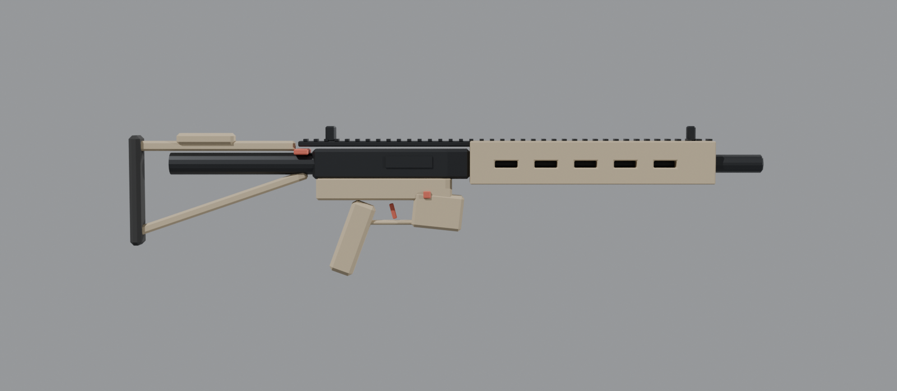
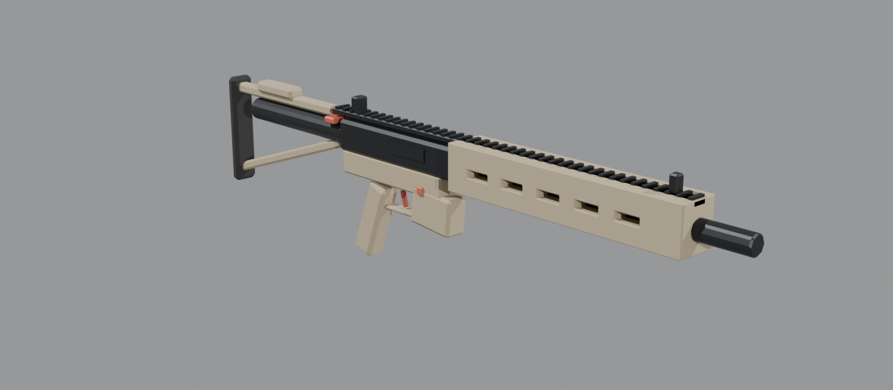

# Allied Forces Weapons Pack

Original weapons for Allied Forces DayZ servers.

## AF-7 "Vanguard" (in progress)

An original Allied Forces assault rifle in 5.56×45mm. It has an angular, two-tone design, a long slotted handguard, a full-length top rail, a skeleton stock and a hex-shaped muzzle brake.

Its layout matches the M4, so it reuses DayZ's M4 animations, sounds and recoil. It takes vanilla STANAG magazines, optics and muzzle devices.



*Starting blockout. The red parts move in game. You shape this into the final design.*

| Spec | Value |
|---|---|
| Class name | `AF7_Vanguard` |
| Caliber | 5.56×45mm (STANAG magazines) |
| Length | ~0.89 m |
| Weight | 3.2 kg |
| Handling | Slightly less recoil and sway than an M4 |
| Loot | Military, Tier 3–4, rare (nominal 3) |

### Progress
- [x] Blockout (`blender/`)
- [x] Config, model.cfg, rvmat and loot files (`source/`, `server/`)
- [ ] Final model in Blender
- [ ] UVs and textures
- [ ] LODs and `.p3d`
- [ ] In-game test (hands, sights, reload)

**Step-by-step instructions are in [docs/GUIDE.md](docs/GUIDE.md).**

## Repo layout
```
blender/af7_vanguard_blockout.py      script that builds the starting blockout
blender/af7_vanguard_blockout.blend   same blockout, ready to open
docs/GUIDE.md                         Blender -> DayZ, step by step
source/AF_Weapons/                    the addon (copy to P:\AF_Weapons)
  config.cpp                          weapon definition
  af7_vanguard/model.cfg              bones / selections
  af7_vanguard/data/af7_body.rvmat    material (textures go in this folder)
@AF_WeaponsPack/                      finished mod folder (mod.cpp, Keys/, Addons/ after building)
server/af_ce/                         loot economy files for the mission folder
build.bat                             packs and signs the PBO with DayZ Tools
```

## Build
1. Install **DayZ Tools** from Steam.
2. Run `build.bat`. The first run creates the signing key in `keys/`. Never share or commit the `.biprivatekey`.
3. The result is `@AF_WeaponsPack\Addons\AF_Weapons.pbo` with its signature.

Until the custom model exists, the Vanguard uses the vanilla M4 model. You can already build it and test loot spawning (see the top of `config.cpp`).

## Install on the server
1. Copy `@AF_WeaponsPack` to the server root.
2. Copy `@AF_WeaponsPack\Keys\*.bikey` to the server's `keys\` folder.
3. Add `-mod=@AF_WeaponsPack` to the launch line, separated from your other mods by `;`.
4. Copy `server/af_ce` into your mission folder. Then add this inside `<economycore>` in that mission's `cfgeconomycore.xml`:
   ```xml
   <ce folder="af_ce">
       <file name="af_weapons_types.xml" type="types" />
       <file name="af_weapons_spawnabletypes.xml" type="spawnabletypes" />
   </ce>
   ```
5. Restart the server, then check the `.RPT` log for `AF_Weapons` errors.
